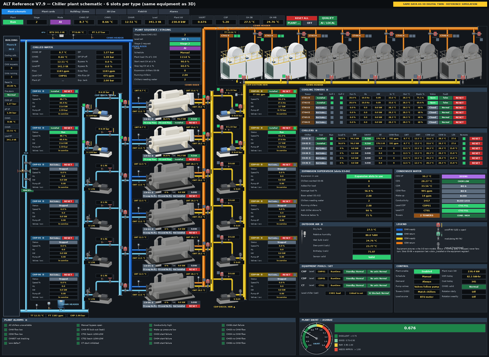

# ALT_CP_Ref_V7_9 — Chiller Plant Reference Station (Niagara 4.15)

Reference station for the chiller plant management system (CPMS), version **V7.9**: an 8-storey building, a chiller plant on floor 1, cooling towers on the roof, and an air side on floors 2–8. The station supports up to **6 units of each type** (chiller / CHP / CDP / CT). Each unit can be added or removed with its `<slot>_Installed` flag or from the Equipment Register.



> The station databases (`config.bog`) are **not** in this repository because they contain users and password hashes. Build them with the scripts in `tools/` (see below), or copy them from a working station.

## Repository layout

| Folder | Contents |
|---|---|
| `station/shared/px/` | All Px graphics (`ALT_V79_Plant.px` = Px_Plant, 6-slot schematic) and images in `img/` |
| `station/shared/web/` | `ALT_V79_Building3D.html` — the 3D digital twin (BajaScript LIVE, opens in DEMO mode when not on the station) |
| `tools/` | Python builders for the station (wire sheet, logic, simulation) and the Px generator |
| `tools/studio/` | Renders equipment pictures (chiller / pump / tower) from the 3D models for use in the Px |
| `graphics3d/` | Source of the 3D page (three.js): `scene79.js`, `model79.py`, `gen3d79.py`, point mapping |
| `java/altPlant/` | Niagara module source: `ExpansionSupervisor`, `ZoneAggregator` (see `java/altPlant/README_TH.md`) |
| `registers/` | Equipment Register (xlsx), point list, alarms, history, field I/O, tags, change log |
| `drawings/` | 2D drawings (PDF / DXF) and the logic overview |
| `bim/` | IFC model and BOM/BOQ |
| `tests/` | Simulation test results (V7.7–V7.9) |
| `docs/` | User guide (Thai) and the plant schematic preview |

## Deploying to a station

1. Copy `station/shared/px/*` → `<station>\shared\px\` and `station/shared/web/*` → `<station>\shared\web\`. Px pages update without a restart.
2. If the logic changed, rebuild the `config.bog` (below), stop the station, swap in the new file, then start it again.
   - For a station under `C:\ProgramData\...`, the root tag and the user password must be re-encrypted with the platform keyring first. Station Copier does this for you.

## Building the station (config.bog)

```bash
pip install -r requirements.txt
tools/rebuild_v79.sh <source c_v5.bog> <groups c_v5.tsv> [out dir] [register.xlsx]   # both builds + offline tests
# or step by step:
cd tools
python3 check_v79_refs.py --register ../registers/ALT_V79_Equipment_Register.xlsx     # offline reference check, no bog needed
python3 make_v79.py <source c_v5.bog> <groups c_v5.tsv> <out>/v79.bog \
    --regdir <out>/reg --timing site --register ../registers/ALT_V79_Equipment_Register.xlsx [--cert-alias <alias>]
python3 v79tests.py <out>/v79_fpt.bog <out>/v79tests.csv   # add / remove equipment + air side tests (22 cases, exit 1 on a finding)
python3 gen_px79d.py <out>/v79.bog <kitPxGraphics dir> <pxout> <sprites73> <sprites74> <studio raw>
```

- kitPxGraphics images, the input `c_v5.bog` and the `lotus/` helpers are not included — see `tools/README.md` ("Inputs that are not in this repository") and the environment variables there.
- `tools/README.md` lists which scripts belong to the V7.9 build chain and which are earlier versions.

## 3D page

```bash
cd graphics3d && npm ci
V79_REGDIR=<out>/reg LOTUS_DIR=<lotus> python3 gen3d79.py   # full rebuild (data + page) -> out/ALT_V79_Building3D.html, map79.json
python3 rebuild_page.py                                      # page template / scene changed only: rebuild the station page in place
```

## Checks (CI, every push)

Secrets / absolute paths, Python compile + lint, V7.9 builder references (`tools/check_v79_refs.py`), Px XML / images / ORDs / 3D map
(`tools/check_px.py`), 3D page = its sources (`graphics3d/rebuild_page.py --check`), Java logic unit tests and a type-check of the
Niagara components against API stubs (`java/altPlant/logic-test`, `java/altPlant/ci-stubs`).

## Version

**V7.9 r4** (R9 office design + realistic graphics, see `docs/R4_Office_VAV_TH.md`):
- R9 package imported: office design data (`graphics3d/data/office79.json`), basement-plant geometry, 15 Px pages, 4 HTML pages, 2D symbols.
- New logic `tools/v79_office.py`: floors 2-8 VAV AHUs (ASHRAE G36 duct static / SAT Trim & Respond, PICV, dehumidification, measured
  minimum OA by ASHRAE 62.1 VRP with DCV, high-static safety), 123 VAV boxes, 200 room sensors, floor BTU / power and tenant meters.
- Plant: expansion chiller freeze trip and anti-recycle, tower basin low-low, B1 plant room flood protection.
- Blender models (`tools/blender/equipment79.py`): chiller, pump, tower, AHU, VAV, fan -> GLB for the 3D page + Cycles renders for Px.
- 3D page: B1 plant room, Blender models, office layer (rooms by T / RH / CO2, ducts, VAV, live airflow), room info.
- Live Px: `ALT_V79_VAV_Overview.px`, `ALT_V79_F02_VAV.px` ... `F08` (`tools/gen_px79o.py`).
- Executable layer test station (`tools/layer_sim.py`) + 17 tests in CI.


**V7.9 r3** (review fixes):
- Expansion slots: run-hour rotation (running units are never swapped), soft-load and head-pressure valve for chillers 03-06.
- `CHX_ChillersNeedingWater` now shows the value the pump / tower targets use; the old value is `CHX_ChillersValvesOpen`.
- Floors 2-8: RH average and "all zones out of service" handling, start-failure latch uses `sealin`, CO2 simulation.
- Field IO device numbers are pinned (register `Device` column overrides the BACnet device).
- `make_v79.py`: keeps every entry of the .bog, clear errors, `--cert-alias`.
- Java module: same rules as the wire sheet, fail-safe on invalid inputs, unit tests.
- 3D page: no `document.write`, batched ORD resolve, unresolved points reported; Px "3D Live" opens the HTML page (HTML5 profile).
- No absolute paths; `requirements.txt`, `package-lock.json`.


**V7.9 r2:**
- 6-slot schematic at V7.8 detail level.
- Equipment pictures rendered from the 3D models.
- Full field points for slots 03–06 (Hz, kW, pressure, temperature, RT, kW/RT, lift).
- 3D page fix (black screen).
- Java module source.

Earlier history is in `registers/V7_CHANGE_LOG.csv`.

---
© 2026 AETERLINK (Thailand) Co., Ltd. — proprietary, see `LICENSE`.


# Claude Code — ALT CPMS Niagara V7.9

Repository: `PoomKit/alt-cpms-niagara-v79`  
Target platform: Niagara 4.15

## Working principles
- Complete the user's requested task accurately with minimal unnecessary token use.
- Reply in concise Thai; retain English technical terminology.
- Do not repeat instructions, long explanations, logs, or large code blocks unless requested.
- Ask questions only when a missing decision blocks safe implementation.
- Be accurate about what was inspected, modified, built, and tested.

## Efficient workflow
1. Define the requested scope and identify relevant files by path or symbol search.
2. Read only necessary files and ranges; avoid repository-wide scans unless justified.
3. Identify root causes before editing.
4. Make small, focused changes following existing conventions.
5. Run relevant targeted checks; run full builds only when needed.
6. Review the diff for unrelated changes and sensitive data.
7. Summarize the result briefly.

Avoid redundant searches, repeat file reads, excessive command output, and unnecessary documentation. Never trade correctness or required verification for token savings.

## Project safeguards
- Preserve existing Niagara station behavior, control sequences, Px graphics, Java modules, 3D assets, and interfaces unless the task explicitly changes them.
- Respect Niagara 4.15 and existing Java/Gradle module compatibility.
- Reuse existing architecture and dependencies. Do not invent Niagara APIs.
- Never expose or commit credentials, licenses, certificates, secrets, client data, or site network details.
- Do not change unrelated files, production settings, or deployments.
- Do not delete operational files or data without explicit approval.

## Git workflow
- Keep commits focused. Use a task branch and pull request for code changes when possible.
- Do not merge, deploy, or push directly to `main` without explicit authorization.
- Do not create a pull request unless requested or necessary for the selected workflow.

## Validation
- Report tests as PASS, FAIL, or NOT RUN; explain missing tools or licenses.
- Never claim a successful Niagara build or runtime test without actually verifying it.
- If Niagara SDK/runtime is unavailable, perform the checks that are possible and state the limitation.

## Response format
**Status:** PASS / PARTIAL / BLOCKED  
**Changes:** One-line summary  
**Files:** Changed file paths  
**Tests:** PASS / FAIL / NOT RUN  
**Issues:** Unresolved issues only  
**Next:** One action if needed

For review-only requests, do not edit files. For implementation requests, proceed with the change and validation without stopping at analysis.
